
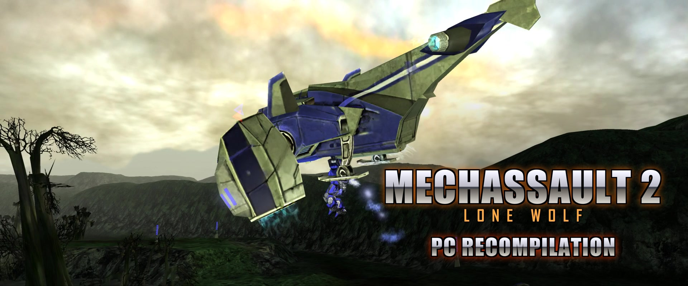

An unofficial PC port of MechAssault 2: Lone Wolf (Xbox, 2004). You need your own copy of the game to use it. There are no game files in this repo or in the releases.

<!-- trailer goes here -->

MechAssault 2 never came out on PC. This project takes the game's code off your own disc, recompiles it into a native Windows program using [xboxrecomp](https://github.com/sp00nznet/xboxrecomp), and puts a PC layer on top for graphics, input and settings. It's the original game code running natively, not a full emulator, although the Xbox audio chip and GPU are still emulated.

Not affiliated with Microsoft, Day 1 Studios or anyone who owns BattleTech / MechWarrior.

## The campaign, with PC features

The whole single-player campaign is here, every mission and cutscene, with the things you'd want from a PC version:

- Any resolution, including widescreen and ultrawide, with the HUD fixed to fit
- Frame rates up to 360 FPS
- Keyboard and mouse or a controller, fully rebindable. You can switch between them mid-game and the button prompts change to match.
- The menus work with the mouse, so you can point and click your way through them
- Extended draw distance
- Cutscenes that fill a widescreen display and run at 60 FPS
- Optional 2x/4x upscaled textures, generated on your own PC (needs an NVIDIA card and takes hours)

| | |
|:-:|:-:|
| 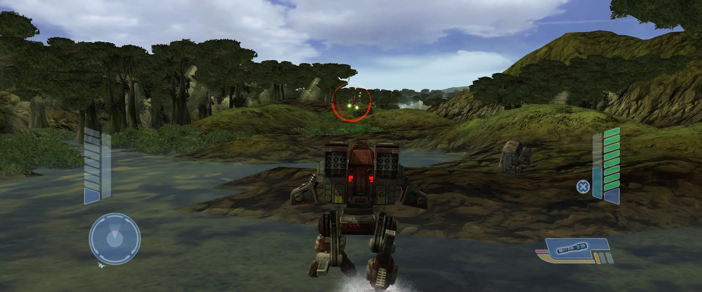 | 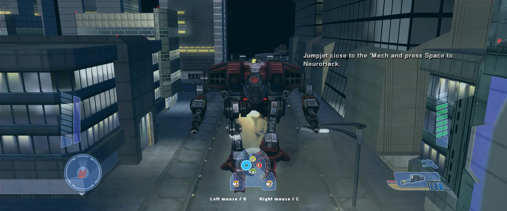 |
| The campaign in ultrawide | Button prompts follow the keyboard and mouse |

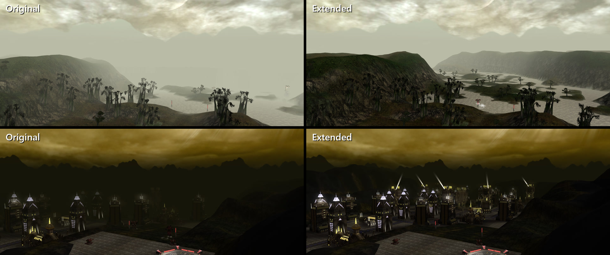

Draw distance on two maps: the original setting on the left, extended on the right.

## Bot matches

Every multiplayer mode can be played offline against bots, on every map.

The bots play to win the mode rather than just shooting at you:

- They go for the objective, whether that's a flag, a core or a terminal
- They use everything in the game: 'Mechs, tanks, VTOLs and Battle Armor. VTOL pilots pick up Battle Armor teammates and fly them across the map.
- They NeuroHack enemy 'Mechs, raise their own defences and pick weapons to suit the target
- Five difficulty levels from Green to Dragoon, plus Mixed. Harder bots aim, react and decide better. They never get extra damage or armour.
- Up to six a side

| | |
|:-:|:-:|
| 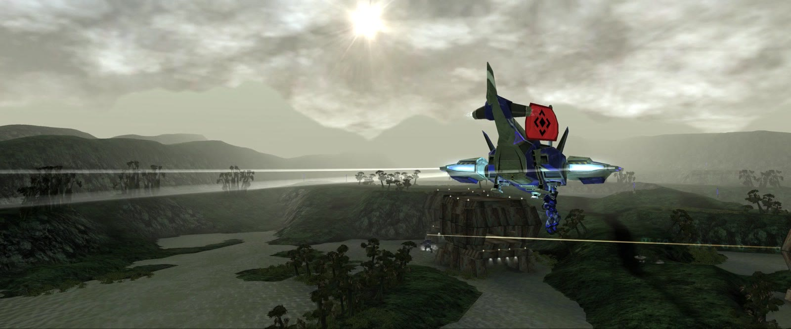 | 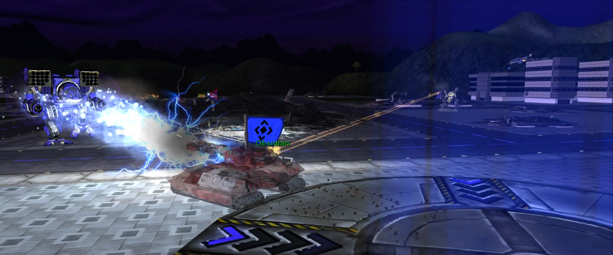 |
| A bot VTOL carrying a Battle Armor teammate who has the enemy flag | A bot tank makes off with the flag while a defender opens fire |

## Scenario editor

The MA2 Scenario Editor installs alongside the game. You can build your own campaign missions, with objectives, triggers and cutscenes, or your own multiplayer maps, out of the game's terrain, buildings and units. Press Test and you're playing it a few seconds later. Custom multiplayer maps work with bots too.

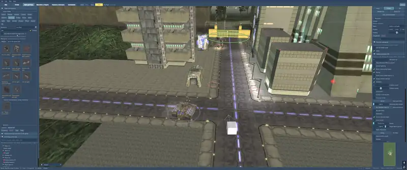

| | |
|:-:|:-:|
| 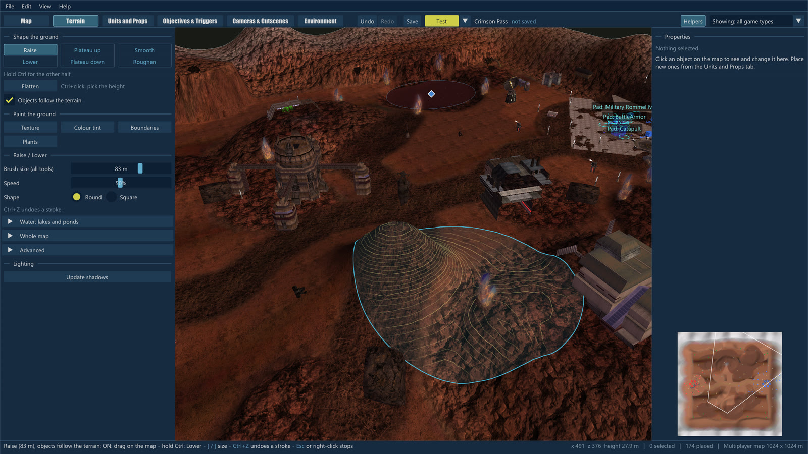 | 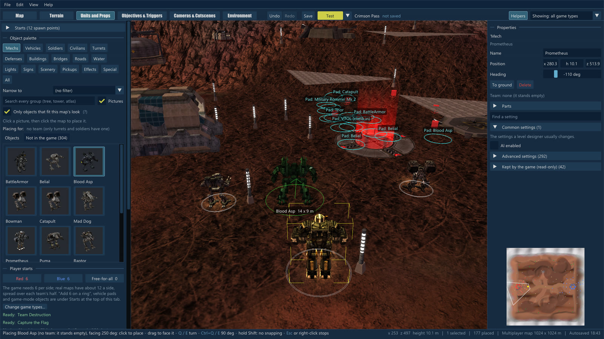 |
| Sculpting terrain | Placing 'Mechs from the palette |
| 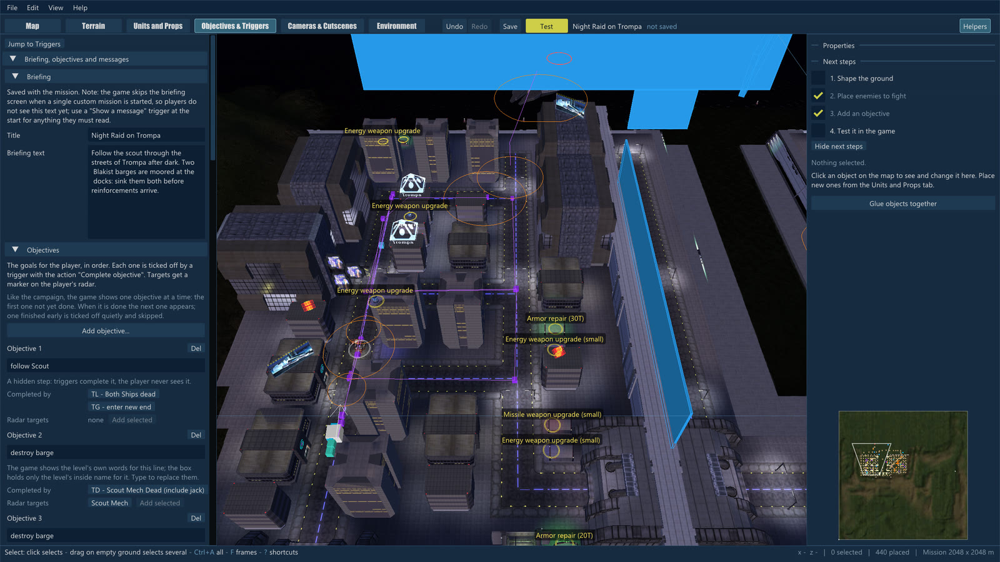 | 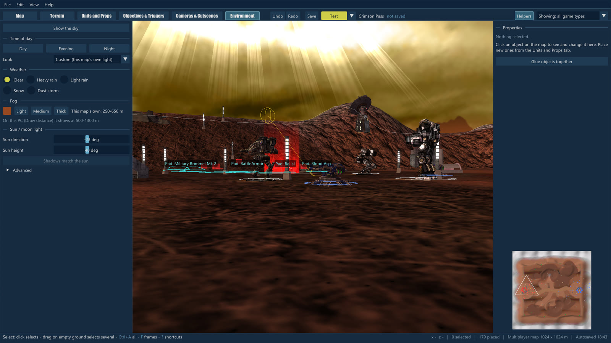 |
| Writing a mission's briefing and objectives | Time of day, weather and fog |
| 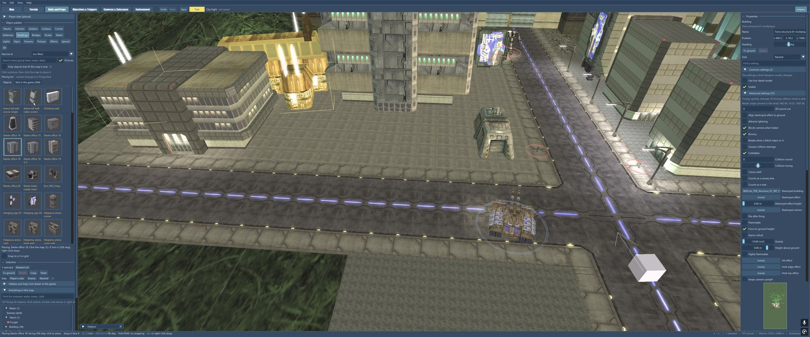 | 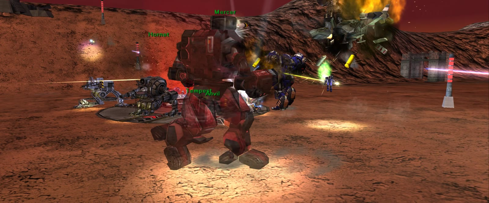 |
| Editing a custom scenario in the scenario editor | A custom multiplayer map being played |

Your scenarios are saved as single files in `Documents\MechAssault 2\Scenarios` and show up in the game's Custom Scenarios menu.

## Installing

What you need:

- A dump of your own US (NTSC) MechAssault 2 disc, as an ISO/XISO or an extracted folder. Regular PC DVD drives can't read Xbox discs, so you have to dump it yourself.
- Windows 10 or 11, 64-bit, and a GPU that does Direct3D 11
- About 5 GB of free space. If you don't have Visual Studio or the C++ Build Tools, the installer can install them for you, which needs another 8 GB or so.
- An internet connection during the install. It downloads FFmpeg, which the cutscenes need.

It has been tested mainly on a desktop with an RTX 3090 and an i9-12900K, and to a lesser degree on a laptop with an i7-1260P and Iris Xe graphics.

Steps:

1. Download `MechAssault 2 Recomp Installer.exe` from [Releases](https://github.com/Mazillion/MechAssault2-PC-Recomp/releases/latest).
2. Run it and point it at your disc dump.
3. Wait while it builds the game. This takes around 15 minutes on a decent 8-core CPU.
4. Launch MechAssault 2 from the shortcut.

The installer isn't signed, so Windows SmartScreen will warn you about it. Click "More info", then "Run anyway". If you have Smart App Control turned on, it will block the installer completely. The [install guide](kit/defaults/Docs/Install%20guide.txt) covers that, and installing without internet.

You can run the installer again later to update, repair or uninstall.

## Known issues

- AMD graphics cards haven't been tested. Intel integrated graphics showed a tinted picture and a low frame rate on one laptop, and that isn't explained yet.
- The first time you load each level it can run badly for a few seconds while shaders compile. It's fine after that.
- Only the US disc works. PAL and Japanese discs aren't supported.
- Every mission and cutscene loads and runs, but I haven't played all of them through to the end on this build.
- No online multiplayer.

The full list is in [Known issues.txt](kit/defaults/Docs/Known%20issues.txt). If the game crashes, run the installer again and hit "Collect diagnostics", then attach the zip it makes to an [issue](https://github.com/Mazillion/MechAssault2-PC-Recomp/issues). Don't attach game files.

## Building and modding

Everything in the release is built from this repo. [docs/building.md](docs/building.md) explains how to build it yourself. The rest of [docs/](docs/README.md) has notes on how the port works, the bots, the editor, and a big pile of research notes on the game's code.

## Credits

- [xboxrecomp](https://github.com/sp00nznet/xboxrecomp) by sp00nz, the recompiler toolkit and runtime this is built on
- [xemu](https://github.com/xemu-project/xemu), for the audio and GPU code the runtime adapts
- [MGF-Explorer](https://github.com/LarvalExtract/MGF-Explorer) by LarvalExtract, for the MGF archive format
- Dear ImGui, FFmpeg, Capstone and the rest listed in [THIRD-PARTY-NOTICES.md](THIRD-PARTY-NOTICES.md)
- Day 1 Studios and Microsoft Game Studios, for making the game

AI coding tools were used in making this project.

## Legal

This is a free fan project and it will never be sold. MechAssault, Xbox and Microsoft are trademarks of Microsoft. BattleTech, MechWarrior and BattleMech are trademarks of their owners. MechAssault 2: Lone Wolf is © Microsoft Corporation. This project isn't affiliated with or endorsed by any of them.

The screenshots and trailer on this page were created under Microsoft's "Game Content Usage Rules" using assets from MechAssault 2: Lone Wolf, and are not endorsed by or affiliated with Microsoft.

The project's own code is MIT licensed, see [LICENSE](LICENSE). Rights holders, see [LEGAL.md](LEGAL.md) for how to reach me.
